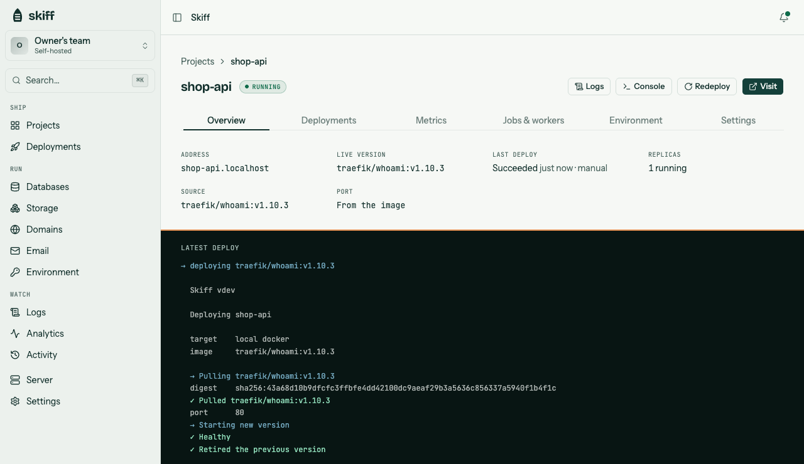

<h1></h1>

[](https://github.com/nuelScript/skiff/releases)
[](https://github.com/nuelScript/skiff/actions/workflows/test.yml)
[](#license)

<picture>
  <source media="(prefers-color-scheme: dark)" srcset="web/brand/dashboard-dark.png">
  
</picture>

**Ship it to a server you own.** Push-to-deploy with a web console, automatic HTTPS, managed databases, and preview environments — running on infrastructure you control, not rented. One small Go binary detects your stack, builds it, and runs it on Docker, local or over SSH.

```
$ skiff deploy

  Skiff v0.5.0

  Deploying myapp
  target   local docker
  build    Node.js

  ✓ Built skiff-myapp:latest
  ✓ Healthy
  ✓ Live at http://myapp.localhost:8080  (2.4s)
```

## Install

macOS / Linux:

```bash
curl -fsSL https://useskiff.xyz/cli | sh
```

Or with Homebrew: `brew install nuelScript/tap/skiff`.
Or with Go (any platform): `go install github.com/nuelScript/skiff@latest`.

You'll need Docker running to build and deploy apps.

## Quickstart

In your app's directory:

```bash
skiff proxy      # once, in its own terminal — the local *.localhost router
skiff init       # scaffold a skiff.toml
skiff deploy     # build + run → http://<app>.localhost:8080
```

Then `skiff open <app>` opens it. Want to try it without an app of your own? Clone
the repo and deploy an example:

```bash
git clone https://github.com/nuelScript/skiff && cd skiff
go build -o skiff . && ./skiff deploy -c examples/node-hello/skiff.toml
```

## What it builds

No Dockerfile required — Skiff detects the stack and generates the build:

| Stack | Detected by |
|---|---|
| **Node.js** | `package.json` — framework-aware (Next, Vite, Astro, SvelteKit, Remix, Nuxt, …) |
| **Python** | `requirements.txt` / `*.py` |
| **Go** | `go.mod` → multi-stage, tiny image |
| **Rust** | `Cargo.toml` → multi-stage |
| **Ruby** | `Gemfile` |
| **Elixir** | `mix.exs` → `mix release` |
| **Java** | Maven / Gradle |
| **.NET** | `*.csproj` |
| **PHP** | `index.php` |
| **Static** | `index.html` |

Have a `Dockerfile`? Skiff uses it instead. Need to tweak a step? Set `[build]`
commands in `skiff.toml` — the escape hatch short of a full Dockerfile. Already
built? Set `image` under `[build]` and Skiff pulls it instead.

## The platform

Run the web console with `skiff panel` (or set it up on a server) for the whole
platform in the browser:

- **Push-to-deploy** — connect GitHub and every push builds and ships, with
  zero-downtime rollout and instant rollback.
- **Preview environments** — every branch gets its own live URL and certificate,
  posted on its pull request and removed when the branch is deleted. In a
  monorepo, only projects whose folder the branch changed get one. Put them
  behind a password to keep work in progress private.
- **Observability** — per-project requests, errors, latency, visitors, top pages
  and referrers, with deploys marked on the charts, plus uptime checks and
  incidents.
- **Cost** — what each app, database and bucket costs per month out of your
  server's price, and how much room is left.
- **Sleep when idle** — stop quiet apps to free their memory; the next visit
  wakes them.
- **Managed databases** — Postgres, MySQL, MongoDB, and Redis, provisioned and
  wired into your apps, with automatic daily backups (optionally copied to any
  S3-compatible bucket). Databases you started by hand can be brought under
  management too.
- **Object storage** — S3-compatible buckets, with a file browser in the dashboard.
- **Email forwarding** — point a domain's MX at your server and send
  `hello@yourdomain.com` to any inbox, catch-all included.
- **Custom domains + automatic HTTPS** — Let's Encrypt certificates, issued and
  renewed for you.
- **Autoscaling** — add and retire replicas to hold each app near a target CPU.
- **Workers & cron** — long-running background processes and scheduled jobs.
- **One-click apps** — install Uptime Kuma, n8n, Ghost, Umami, Vaultwarden or Gitea,
  with storage, secrets and any database set up for you.
- **Prebuilt images** — run any image from Docker Hub or a private registry, and
  point it at a new tag from CI with one API call.
- **Persistent volumes** — directories that keep their files across deploys, for
  SQLite databases and uploads; previews get empty copies of their own.
- **Log drains** — send every project's logs to Better Stack, Axiom, Datadog or
  any HTTP endpoint, resuming where it stopped after an outage.
- **Private services and rate limits** — internal APIs with no public address,
  reached by a stable name, and per-project limits at the edge.
- **Limits** — memory and CPU per replica, with a safety cap for apps that set none,
  so one runaway app can't take the others down.
- **Status pages** — a public page with 30 days of uptime for the projects you
  choose, on your own domain if you like.
- **Alerts** — email, Slack, or webhook when a deploy fails, an app goes down or runs
  out of memory, or 5xx errors spike.
- **Teams, audit log, and API tokens** — collaborators, an activity trail, and a
  token-authenticated API for CI.
- **Two-factor sign-in** — authenticator-app codes for the dashboard, with
  recovery codes.
- **Agents** — `skiff mcp` lets an AI assistant list projects, deploy, read logs
  and traffic, change env vars and roll back.

Apps shipped with `skiff deploy` show up in the console too, with their history,
logs, metrics and rollback.

## Commands

| | |
|---|---|
| `skiff init` | scaffold a `skiff.toml` |
| `skiff deploy` | build + zero-downtime deploy |
| `skiff rollback` | instantly re-run a retained build, no rebuild |
| `skiff open <app>` | open a deployed app's URL |
| `skiff status` / `skiff ls` | app state + health / list apps |
| `skiff logs [-f] <app>` | app logs |
| `skiff down <app>` | stop + remove |
| `skiff sync` | prune orphans / dead entries |
| `skiff proxy` | local `*.localhost` router |
| `skiff server setup <user@host>` | bootstrap Docker on a fresh box over SSH |
| `skiff login <dashboard>` / `logout` / `whoami` | sign the CLI in, so deploys land in your team and use dashboard env vars |
| `skiff mcp` | serve your projects to AI agents over MCP |
| `skiff server restore <file>` | rebuild Skiff's state on a new server from a backup |

The control plane itself — the web console (`skiff panel`) and edge router
(`skiff router`) — is normally run for you by the [server installer](#run-it-on-your-own-server).

## skiff.toml

```toml
name = "myapp"

[build]
port = 3000              # the port your app listens on
# dockerfile = "Dockerfile"
# image = "ghcr.io/you/app:1.4"   # run a prebuilt image instead of building

[env]                    # available at build + runtime
API_URL = "https://api.example.com"

[secrets]                # runtime only — never baked into the image
API_KEY = "..."

[resources]              # per replica; with no memory limit, an app can use up to 75% of the server
memory = "512m"
cpu    = "0.5"

[deploy]
release        = "npm run migrate"  # runs once before each new version goes live
health_path    = "/healthz"         # must answer 2xx/3xx before traffic moves
health_timeout = 60                 # seconds (default 30)

[[volumes]]              # kept across deploys; repeat for more (up to 5)
name = "data"
path = "/data"

# [server]               # omit for local Docker
# host = "root@1.2.3.4"  # deploy to a remote box over SSH
```

A `.env` file next to `skiff.toml` is loaded too.

## Zero-downtime

Every deploy builds the new version, health-checks it, atomically cuts traffic over, then drains and retires the old one. If the new version never becomes healthy, it rolls back and the old one keeps serving. By default any HTTP response counts as healthy; set a `health_path` (or **Health check path** in project settings) to require a 2xx or 3xx from a real check instead.

## Run it on your own server

One command on a fresh Ubuntu/Debian box sets up the whole platform — Docker, the
edge router (`:80`/`:443` with automatic HTTPS), and the web console:

```bash
curl -fsSL https://useskiff.xyz/install | sh -s -- --domain example.com
```

Point `*.example.com` at the box, open `https://dash.example.com`, and log in with
the setup key it prints. The full walkthrough is in the
[self-hosting guide](https://useskiff.xyz/docs/self-hosting).

Prefer the CLI? `skiff server setup user@host` bootstraps Docker on a box so you
can `skiff deploy` to it over SSH.

### Moving to a new server

Skiff backs up its own state every day to your offsite bucket, sealed with a
recovery key you can view on the Server page. On the new box, install Skiff, then:

```bash
skiff server restore skiff-<date>.skiffbak --key <recovery key>
```

Projects, settings, domains and tokens come back as they were, and each managed
database is recreated and loaded from its newest offsite backup.

## Contributing

Contributions are welcome — see [CONTRIBUTING.md](CONTRIBUTING.md) to get set up, and please follow our [Code of Conduct](CODE_OF_CONDUCT.md). Found a security issue? Report it privately per [SECURITY.md](SECURITY.md) — not in a public issue.

## License

Dual-licensed under either [MIT](LICENSE-MIT) or [Apache-2.0](LICENSE-APACHE), at your option.
